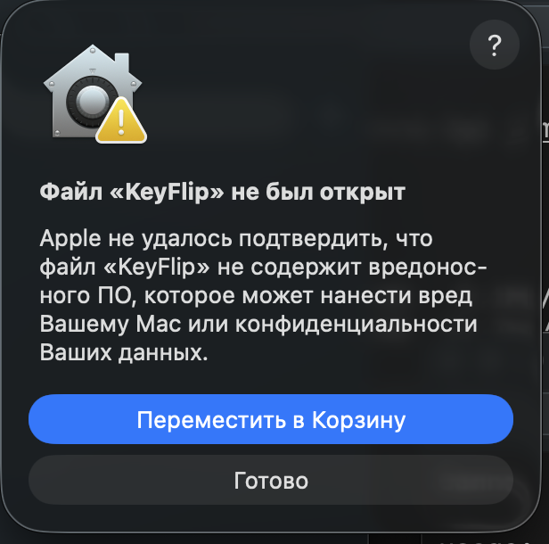

# Installing SwapType

[Русский](INSTALL.ru.md) · [Back to overview](README.md)

Takes a couple of minutes. You need macOS 12 or later (Apple Silicon or Intel) with the Russian and English keyboard layouts enabled.

## 1. Download and drag to Applications

1. Download **SwapType.dmg** from the [latest release](https://github.com/xs1n/swaptype/releases/latest).
   If Chrome blocks the download, open Downloads (⌘⇧J) and click **Keep** — or download with Safari.
2. Open SwapType.dmg and drag **SwapType** onto the **Applications** folder.
3. Launch SwapType from Applications or with Spotlight (⌘ Space → “SwapType”).

## 2. Allow it to open (first launch only)

On first launch macOS shows this window (here in Russian — in English it reads *“SwapType” Not Opened*):

<p align="center"></p>

That's expected: macOS shows it for any app without a paid Apple signature. SwapType is free and works offline — it doesn't send anything anywhere.

1. Click **Done**. ⚠️ Don't click *Move to Trash*.
2. Open **System Settings → Privacy & Security**.
3. Scroll down to the **Security** section. You'll see *“SwapType” was blocked to protect your Mac* — click **Open Anyway**.
4. Enter your Mac password, then click **Open Anyway** once more.

You won't see that window again.

> **No “Open Anyway” button?** It shows for about an hour after a launch attempt. Launch SwapType again, then go straight to Settings.
>
> Or run this in Terminal (it removes the “downloaded from the internet” mark from the app):
>
> ```
> xattr -dr com.apple.quarantine /Applications/SwapType.app
> open /Applications/SwapType.app
> ```

## 3. Allow keyboard access

SwapType has to see what you type — otherwise there's nothing to fix. On first launch it shows a window that walks you through it.

1. In the SwapType window, click the button that opens settings — **Privacy & Security → Accessibility** opens.
2. Switch on **SwapType**. If it isn't in the list, drag its icon from the SwapType window straight into the list (or click **+** and pick SwapType in Applications).
3. The SwapType window closes by itself and a keyboard icon ⌨️ appears in the menu bar. Done — start typing.

## 4. Make it yours (optional)

Click the ⌨️ icon in the menu bar → **Open SwapType…**, or just launch SwapType again:

- **General** — open at login, sound, which ⌥ Option key flips a word;
- **Dictionaries** — your own words (nicknames, brand names, slang) that SwapType leaves alone;
- **Exclusions** — apps where you don't want SwapType.

> The SwapType interface is in Russian.

## How to use it

- Just type: `ghbdtn` becomes «привет» after the space.
- **⌥ Option** (press and release) — flip the last word or the selected text to the other layout.
- **Double Shift** right after a fix — undo it.

## Updating

SwapType updates itself: once a day it checks for a new version and offers to install it — click **Установить** (Install), and it downloads the update, replaces itself and restarts. You can also check any time: menu bar icon → **Проверить обновления…** (Check for updates). Your dictionaries and settings stay.

By hand: download the new SwapType.dmg and drag SwapType to Applications, replacing the old one. Since 1.0.1 the app is signed with its own certificate, so updates keep the Accessibility permission. Only when moving from 1.0 to 1.0.1 allow it once more: remove KeyFlip with **−** in Accessibility, start the app and switch it on.

**From KeyFlip to SwapType** (1.0.2): nothing to do — the update renames the app itself and keeps your settings, dictionaries and permission. Updating by hand? Drag SwapType to Applications and start it; the old KeyFlip moves itself to the Trash.

## Uninstalling

1. ⌨️ menu bar icon → **Quit** (the last menu item).
2. Drag SwapType from Applications to the Trash.
3. Optionally, remove SwapType from **Privacy & Security → Accessibility** (the **−** button).

Something didn't work? [Open an issue](https://github.com/xs1n/swaptype/issues/new/choose) or write to [xsinus@gmail.com](mailto:xsinus@gmail.com).
