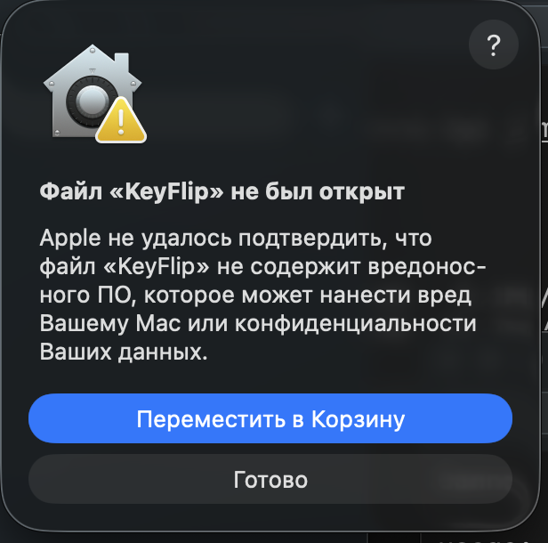

# Установка KeyFlip

[English](INSTALL.md) · [Назад к описанию](README.ru.md)

Займёт пару минут. Нужна macOS 12 или новее (Apple Silicon или Intel) и включённые русская и английская раскладки.

## 1. Скачайте и перетащите в «Программы»

1. Скачайте **KeyFlip.dmg** со страницы [последнего релиза](https://github.com/xs1n/keyflip/releases/latest).
   Если Chrome заблокирует скачивание, откройте загрузки (⌘⇧J) и нажмите **«Сохранить»** — или скачайте через Safari.
2. Откройте KeyFlip.dmg и перетащите **KeyFlip** на папку **«Программы»**.
3. Запустите KeyFlip из «Программ» или через Spotlight (⌘ Пробел → «KeyFlip»).

## 2. Разрешите запуск (только в первый раз)

При первом запуске macOS покажет такое окно:

<p align="center"></p>

Это нормально: так macOS реагирует на любую программу без платной подписи Apple. KeyFlip бесплатный и работает без интернета — ничего никуда не отправляет.

1. Нажмите **«Готово»**. ⚠️ Не нажимайте «Переместить в Корзину».
2. Откройте **«Системные настройки» → «Конфиденциальность и безопасность»**.
3. Пролистайте вниз до раздела **«Безопасность»**. Там будет строка *«Использование „KeyFlip“ было заблокировано…»* — нажмите **«Всё равно открыть»**.
4. Введите пароль от Мака и в следующем окне ещё раз нажмите **«Всё равно открыть»**.

Больше это окно появляться не будет.

> **Нет кнопки «Всё равно открыть»?** Она видна примерно час после попытки запуска. Запустите KeyFlip ещё раз и сразу откройте настройки.
>
> Или выполните в Терминале (снимает с программы метку «скачано из интернета»):
>
> ```
> xattr -dr com.apple.quarantine /Applications/KeyFlip.app
> open /Applications/KeyFlip.app
> ```

## 3. Разрешите доступ к клавиатуре

KeyFlip должен видеть, что вы печатаете, — иначе ему нечего исправлять. При первом запуске он сам покажет окно с подсказкой.

1. В окне KeyFlip нажмите **«Открыть настройки»** — откроется **«Конфиденциальность и безопасность» → «Универсальный доступ»**.
2. Включите переключатель рядом с **KeyFlip**. Если KeyFlip нет в списке — перетащите его значок из окна KeyFlip прямо в список (или нажмите «+» и выберите KeyFlip в «Программах»).
3. Окно KeyFlip закроется само, а в строке меню появится значок клавиатуры ⌨️. Готово — можно печатать.

## 4. Настройте под себя (по желанию)

Нажмите на значок ⌨️ в строке меню → **«Открыть KeyFlip…»**, или просто запустите KeyFlip ещё раз:

- **«Основное»** — запуск при входе в систему, звук, какой ⌥ Option переводит слово;
- **«Словари»** — ваши слова (ники, названия, жаргон), которые KeyFlip не трогает;
- **«Исключения»** — программы, где KeyFlip не нужен.

## Как пользоваться

- Печатайте как обычно: `ghbdtn` после пробела станет «привет».
- **⌥ Option** (нажать и отпустить) — перевести последнее слово или выделенный текст в другую раскладку.
- **Двойной Shift** сразу после исправления — отменить его.

## Обновление

KeyFlip обновляется сам: раз в день он проверяет, нет ли новой версии, и предлагает её установить — нажмите **«Установить»**, и он скачает обновление, заменит себя и перезапустится. Проверить можно и в любой момент: значок в строке меню → **«Проверить обновления…»**. Словари и настройки сохранятся.

Вручную: скачайте новый KeyFlip.dmg и перетащите KeyFlip в «Программы» с заменой. После обновления macOS может попросить заново включить KeyFlip в «Универсальном доступе»: выключите и снова включите переключатель, а если не помогло — удалите KeyFlip кнопкой «−» и добавьте снова кнопкой «+».

## Удаление

1. Значок ⌨️ в строке меню → **«Выйти»**.
2. Перетащите KeyFlip из «Программ» в Корзину.
3. По желанию: уберите KeyFlip из «Конфиденциальность и безопасность» → «Универсальный доступ» (кнопка «−»).

Что-то не получилось? [Напишите в Issues](https://github.com/xs1n/keyflip/issues/new/choose) или на [xsinus@gmail.com](mailto:xsinus@gmail.com).
