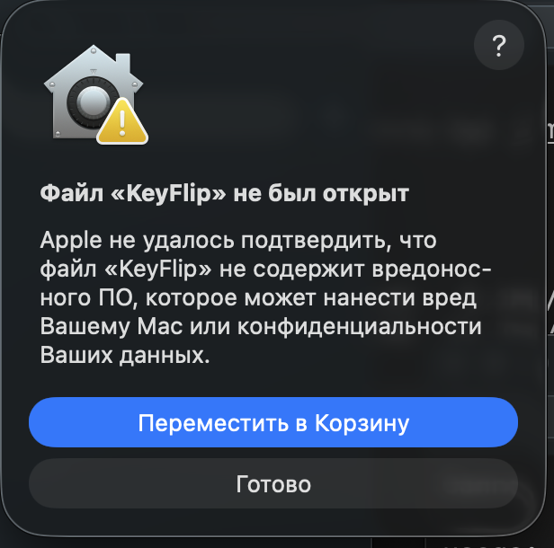

# Установка SwapType

[English](INSTALL.md) · [Назад к описанию](README.ru.md)

Займёт пару минут. Нужна macOS 12 или новее (Apple Silicon или Intel) и включённые русская и английская раскладки.

## 1. Скачайте и перетащите в «Программы»

1. Скачайте **SwapType.dmg** со страницы [последнего релиза](https://github.com/xs1n/swaptype/releases/latest).
   Если Chrome заблокирует скачивание, откройте загрузки (⌘⇧J) и нажмите **«Сохранить»** — или скачайте через Safari.
2. Откройте SwapType.dmg и перетащите **SwapType** на папку **«Программы»**.
3. Запустите SwapType из «Программ» или через Spotlight (⌘ Пробел → «SwapType»).

## 2. Разрешите запуск (только в первый раз)

При первом запуске macOS покажет такое окно:

<p align="center"></p>

Это нормально: так macOS реагирует на любую программу без платной подписи Apple. SwapType бесплатный и работает без интернета — ничего никуда не отправляет.

1. Нажмите **«Готово»**. ⚠️ Не нажимайте «Переместить в Корзину».
2. Откройте **«Системные настройки» → «Конфиденциальность и безопасность»**.
3. Пролистайте вниз до раздела **«Безопасность»**. Там будет строка *«Использование „SwapType“ было заблокировано…»* — нажмите **«Всё равно открыть»**.
4. Введите пароль от Мака и в следующем окне ещё раз нажмите **«Всё равно открыть»**.

Больше это окно появляться не будет.

> **Нет кнопки «Всё равно открыть»?** Она видна примерно час после попытки запуска. Запустите SwapType ещё раз и сразу откройте настройки.
>
> Или выполните в Терминале (снимает с программы метку «скачано из интернета»):
>
> ```
> xattr -dr com.apple.quarantine /Applications/SwapType.app
> open /Applications/SwapType.app
> ```

## 3. Разрешите доступ к клавиатуре

SwapType должен видеть, что вы печатаете, — иначе ему нечего исправлять. При первом запуске он сам покажет окно с подсказкой.

1. В окне SwapType нажмите **«Открыть настройки»** — откроется **«Конфиденциальность и безопасность» → «Универсальный доступ»**.
2. Включите переключатель рядом с **SwapType**. Если SwapType нет в списке — перетащите его значок из окна SwapType прямо в список (или нажмите «+» и выберите SwapType в «Программах»).
3. Окно SwapType закроется само, а в строке меню появится значок клавиатуры ⌨️. Готово — можно печатать.

## 4. Настройте под себя (по желанию)

Нажмите на значок ⌨️ в строке меню → **«Открыть SwapType…»**, или просто запустите SwapType ещё раз:

- **«Основное»** — запуск при входе в систему, звук, какой ⌥ Option переводит слово;
- **«Словари»** — ваши слова (ники, названия, жаргон), которые SwapType не трогает;
- **«Исключения»** — программы, где SwapType не нужен.

## Как пользоваться

- Печатайте как обычно: `ghbdtn` после пробела станет «привет».
- **⌥ Option** (нажать и отпустить) — перевести последнее слово или выделенный текст в другую раскладку.
- **Двойной Shift** сразу после исправления — отменить его.

## Обновление

SwapType обновляется сам: раз в день он проверяет, нет ли новой версии, и предлагает её установить — нажмите **«Установить»**, и он скачает обновление, заменит себя и перезапустится. Проверить можно и в любой момент: значок в строке меню → **«Проверить обновления…»**. Словари и настройки сохранятся.

Вручную: скачайте новый SwapType.dmg и перетащите SwapType в «Программы» с заменой. Начиная с 1.0.1 программа подписана своим сертификатом, и обновления доступ к клавиатуре не сбрасывают. Только при переходе с 1.0 на 1.0.1 доступ нужно выдать ещё раз: в «Универсальном доступе» удалите KeyFlip кнопкой «−», запустите программу и включите её.

**С KeyFlip на SwapType** (1.0.2): ничего делать не нужно — обновление само переименует программу, настройки, словари и доступ сохранятся. Если обновляете вручную, перетащите SwapType в «Программы», запустите его — старый KeyFlip сам уйдёт в Корзину.

## Удаление

1. Значок ⌨️ в строке меню → **«Выйти»**.
2. Перетащите SwapType из «Программ» в Корзину.
3. По желанию: уберите SwapType из «Конфиденциальность и безопасность» → «Универсальный доступ» (кнопка «−»).

Что-то не получилось? [Напишите в Issues](https://github.com/xs1n/swaptype/issues/new/choose) или на [xsinus@gmail.com](mailto:xsinus@gmail.com).
