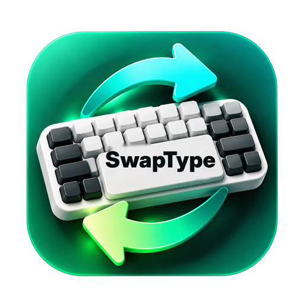
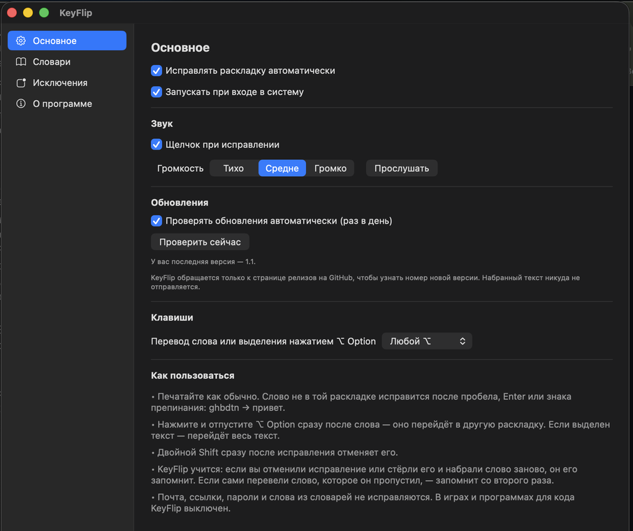

<h1 align="center">KeyFlip</h1>

<b>Free keyboard layout auto-switcher for macOS — Russian ↔ English.</b>

Typed `ghbdtn` instead of «привет»? KeyFlip notices and fixes it as you type, and switches the layout for you. It lives in the menu bar, updates itself, and costs nothing.

[Download the latest version](../../releases/latest) · [How to install](INSTALL.md) · [Русская версия](README.ru.md) · [What's new](CHANGELOG.md) · [Report a problem](../../issues/new/choose) · [☕ Support](#support)

---

## What it does

- **Fixes words typed in the wrong layout.** After a space, Return, Tab or punctuation, KeyFlip checks the word you just typed. If it was clearly meant for the other layout, it retypes it and switches the layout: `ghbdtn` → «привет», `руддщ` → `hello`.
- **Handles short words too.** `d ujhjl` → «в город». If you typed `f`, switched the layout by hand and went on with «не», it still becomes «а не». Real short words stay: «в USB», «a day».
- **Stays out of your way.** Ordinary words, abbreviations and names like ok, zoom, git, docker are left alone.
- **Flip by hand — with the keys you like.** Tap ⌥ Option, double-tap Shift, or set your own shortcut to flip the last word — the whole thing up to the space, digits included: `чы1т` → `xs1n`. Tap again to flip back; right after an automatic fix the same key undoes it. With text selected, the whole selection is flipped. Prefer Caramba-style Shift (double — flip the word, single — switch the layout)? It's one click in the menu.
- **Learns from you.** Undo a fix, or erase it and type the same thing again — KeyFlip remembers the word. Flip a word it missed — it learns it the second time.
- **Two dictionaries: “My words” and “Learned”.** Add your nicknames, brand names and slang to “My words”; “Learned” fills up by itself. Words from either are never changed, and are recognised when typed in the wrong layout. Instant search in either layout, one file to export and import both.
- **Small typo fixes:** «пирогб» → «пирог,», «ПРивет» → «Привет», «пРИВЕТ» (Caps Lock, which KeyFlip then turns off) → «Привет».
- **Particles and glued words:** «почемуто» → «почему-то», «кембы» → «кем бы», «сонатуБаха» → «сонату Баха».
- **Knows brands, abbreviations and slang:** iPhone, YouTube, ООО, PDF, «кринж», bruh are never changed. Typed in the wrong layout they are fixed: `jjj` → «ООО», `nr` → «тк», `n/l/` → «т.д.».
- **Capital letters where they belong:** a word you add to “My words” with a capital («Никита», «GitHub») is always written that way; «ул. ленина» → «ул. Ленина»; words you keep writing with a capital mid-sentence are learned.
- **Leaves addresses and passwords alone.** E-mails, links and domains (`name@gmail.com`, `https://…`) are not touched, and neither is anything that looks like a password.
- **Knows where not to work.** Off in games and in code editors and terminals out of the box; add any other app — “by hand only” or completely off. Need a break? **Pause** for 15 minutes, an hour or three.
- **Sounds and stats.** A quiet click on every fix (any macOS sound or your own file), a different one when a word is learned; how many fixes, undos and new words today and in total.
- **Updates itself.** Once a day KeyFlip checks for a new version and offers to install it — one click, no downloading .dmg files by hand. Or click **Check for updates** any time.

## Install

1. Download **KeyFlip.dmg** from [Releases](../../releases/latest), open it and drag KeyFlip to Applications.
2. On first launch macOS says it can't check the app for malware — that's normal for free apps without a paid Apple signature. Click **Done**, then **System Settings → Privacy & Security → Open Anyway**.
3. Allow KeyFlip in **Privacy & Security → Accessibility** — the welcome window shows you how.

**Step-by-step guide with screenshots: [INSTALL.md](INSTALL.md)**

**Requirements:** macOS 12 Monterey or later, Apple Silicon or Intel, with the Russian and English (US/ABC) layouts enabled.

> The KeyFlip interface is in Russian.

## Privacy

KeyFlip needs Accessibility access because it has to see what you type in order to fix it. Everything happens on your Mac:

- no accounts, no analytics; the only network request is a once-a-day check of this page for a new version (you can turn it off), and an update is downloaded only when you click **Install**;
- typed text is never sent anywhere and never written to disk — while you type, KeyFlip keeps only the current word and its last few fixes in memory;
- the only words saved are the ones in your two dictionaries (“My words” and “Learned”), which you can see, search and delete in the KeyFlip window;
- password fields are hidden from KeyFlip by macOS itself;
- your dictionaries are stored locally in the app's settings and leave your Mac only if you export them.

## Feedback

Found a word KeyFlip gets wrong, or have an idea? [Open an issue](../../issues/new/choose) or write to [xsinus@gmail.com](mailto:xsinus@gmail.com). Russian or English — both are fine.

## 👋 Hi from s1n

KeyFlip is a free app I make in my spare time — no ads, no accounts, no analytics. If it saves you from typing `ghbdtn` one more time and you'd like to say thanks, you can support its development. Every dollar helps and keeps KeyFlip free for everyone. ❤️

### ☕ Support KeyFlip

**Bybit** — send any amount to my Bybit UID **593603995** (Bybit app → Pay / Transfer → to a Bybit user by UID). Transfers between Bybit users are instant and free.

Not into crypto? A ⭐ on this page, a bug report in [Issues](../../issues/new/choose), or telling a friend helps just as much.

## License

KeyFlip is **freeware**: free to use at home and at work, on as many Macs as you like, and free to share. It is not open source. See the [End User License Agreement](LICENSE.md).

KeyFlip includes word lists from [FrequencyWords](https://github.com/hermitdave/FrequencyWords) by Hermit Dave, licensed under [CC BY-SA 4.0](https://creativecommons.org/licenses/by-sa/4.0/) — see [NOTICE](NOTICE.md).

---

Made by **s1n** · © 2026
