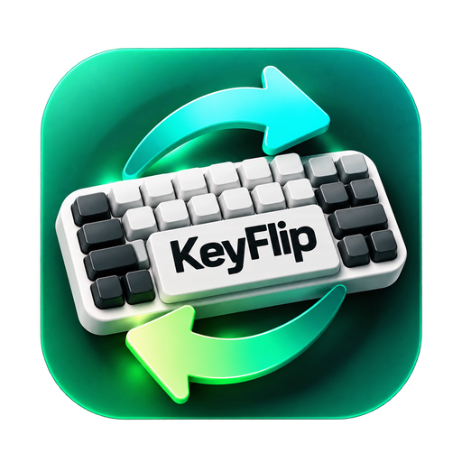
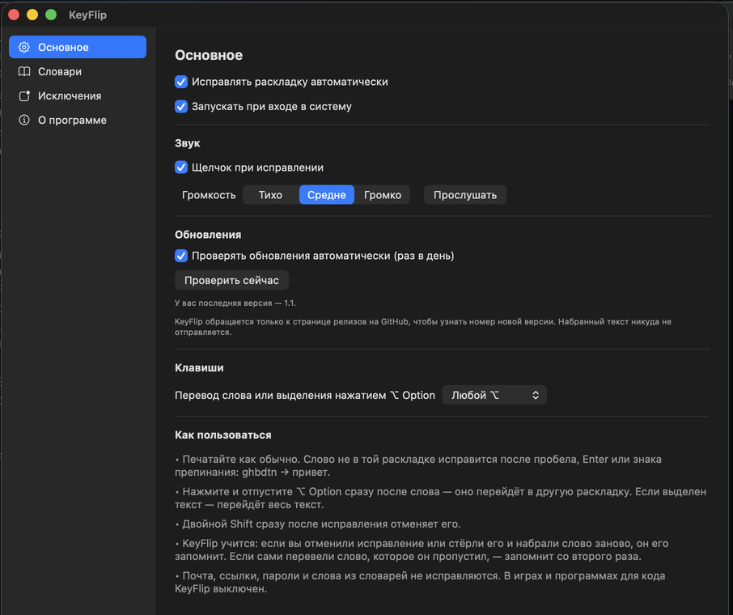

<h1 align="center">KeyFlip</h1>

<b>Бесплатный автопереключатель раскладки для macOS: русская ↔ английская.</b>

Набрали `ghbdtn` вместо «привет»? KeyFlip заметит и исправит прямо во время набора, и раскладку переключит сам. Живёт значком в строке меню, обновляется сам и ничего не стоит.

[Скачать последнюю версию](../../releases/latest) · [Как установить](INSTALL.ru.md) · [English](README.md) · [Что нового](CHANGELOG.md) · [Сообщить о проблеме](../../issues/new/choose)

---

## Что умеет

- **Исправляет слова, набранные не в той раскладке.** После пробела, Enter, Tab или знака препинания KeyFlip проверяет только что набранное слово. Если оно явно предназначалось для другой раскладки — перепечатывает его и переключает раскладку: `ghbdtn` → «привет», `руддщ` → `hello`.
- **Справляется с короткими словами.** `d ujhjl` → «в город». Если набрали `f`, сами переключили раскладку и продолжили «не», получится «а не». Настоящие короткие слова остаются: «в USB», «a day».
- **Не мешает.** Обычные слова, сокращения и названия вроде ok, zoom, git, docker не трогает.
- **⌥ Option — перевод вручную.** Одно нажатие (нажать и отпустить) переводит последнее слово — всё до пробела, вместе с цифрами: `чы1т` → `xs1n`. Повторное нажатие возвращает обратно. Если выделен текст — переводит его целиком. Можно выбрать левый, правый или любой ⌥.
- **Двойной Shift** отменяет последнее исправление.
- **Учится на ваших поправках.** Отменили исправление или стёрли его и набрали то же самое заново — KeyFlip запомнит слово. Сами перевели слово, которое он пропустил, — запомнит со второго раза.
- **Два словаря: «Мои слова» и «Выученные».** В «Мои» добавляйте ники, названия и жаргон; «Выученные» пополняются сами. Слова из словарей не исправляются, а набранные не в той раскладке — узнаются. Мгновенный поиск в любой раскладке, один файл для экспорта и импорта обоих словарей.
- **Мелкие опечатки:** «пирогб» → «пирог,», «ПРивет» → «Привет», «пРИВЕТ» (Caps Lock — KeyFlip его потом выключит) → «Привет».
- **Частицы и склеенные слова:** «почемуто» → «почему-то», «кембы» → «кем бы», «сонатуБаха» → «сонату Баха».
- **Знает бренды и сокращения:** iPhone, YouTube, ООО, PDF не трогает, а `jjj`, набранное не в той раскладке, превращает в «ООО».
- **Не трогает адреса и пароли.** Почта, ссылки и сайты (`name@gmail.com`, `https://…`) остаются как есть, как и всё, что похоже на пароль.
- **Знает, где не работать.** В играх, программах для кода и терминалах выключен сразу; любую другую программу можно добавить в исключения.
- **Тихий щелчок** при исправлении — или без звука, как удобнее.
- **Обновляется сам.** Раз в день KeyFlip проверяет, нет ли новой версии, и предлагает установить её в один щелчок — без ручного скачивания .dmg. Или нажмите **«Проверить обновления»** в любой момент.

## Установка

1. Скачайте **KeyFlip.dmg** в разделе [Releases](../../releases/latest), откройте его и перетащите KeyFlip в «Программы».
2. При первом запуске macOS скажет, что не смогла проверить программу на вредоносное ПО, — так бывает со всеми бесплатными программами без платной подписи Apple. Нажмите **«Готово»**, затем **«Системные настройки → Конфиденциальность и безопасность → Всё равно открыть»**.
3. Разрешите KeyFlip в **«Конфиденциальность и безопасность → Универсальный доступ»** — приветственное окно подскажет, как.

**Подробная инструкция со скриншотом: [INSTALL.ru.md](INSTALL.ru.md)**

**Нужно:** macOS 12 Monterey или новее, Apple Silicon или Intel, включённые русская и английская раскладки.

## Конфиденциальность

KeyFlip нужен «Универсальный доступ», потому что он должен видеть набираемый текст, чтобы его исправлять. Всё происходит на вашем Маке:

- без регистрации и аналитики; в интернет KeyFlip выходит только раз в день — узнать на этой странице, нет ли новой версии (можно выключить), а скачивает обновление, только когда вы нажмёте **«Установить»**;
- набранный текст никуда не отправляется и не записывается на диск — пока вы печатаете, KeyFlip держит в памяти только текущее слово и несколько последних исправлений;
- сохраняются только слова из двух словарей («Мои слова» и «Выученные»), их можно посмотреть, найти и удалить в окне KeyFlip;
- поля паролей macOS сама скрывает от KeyFlip;
- словари хранятся в настройках программы на вашем Маке и покидают его, только если вы сами их экспортируете.

## Обратная связь

Нашли слово, которое KeyFlip исправляет неправильно, или есть идея? [Напишите в Issues](../../issues/new/choose) или на [xsinus@gmail.com](mailto:xsinus@gmail.com). Можно по-русски.

## Лицензия

KeyFlip — **бесплатная программа (freeware)**: можно бесплатно пользоваться дома и на работе, на любом количестве Маков, и делиться ею. Исходный код закрыт. Подробно — в [пользовательском соглашении](LICENSE.md).

В KeyFlip используются списки слов [FrequencyWords](https://github.com/hermitdave/FrequencyWords) (Hermit Dave) по лицензии [CC BY-SA 4.0](https://creativecommons.org/licenses/by-sa/4.0/) — см. [NOTICE](NOTICE.md).

---

Создатель — **s1n** · © 2026
