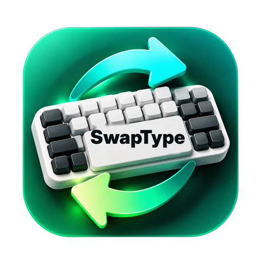
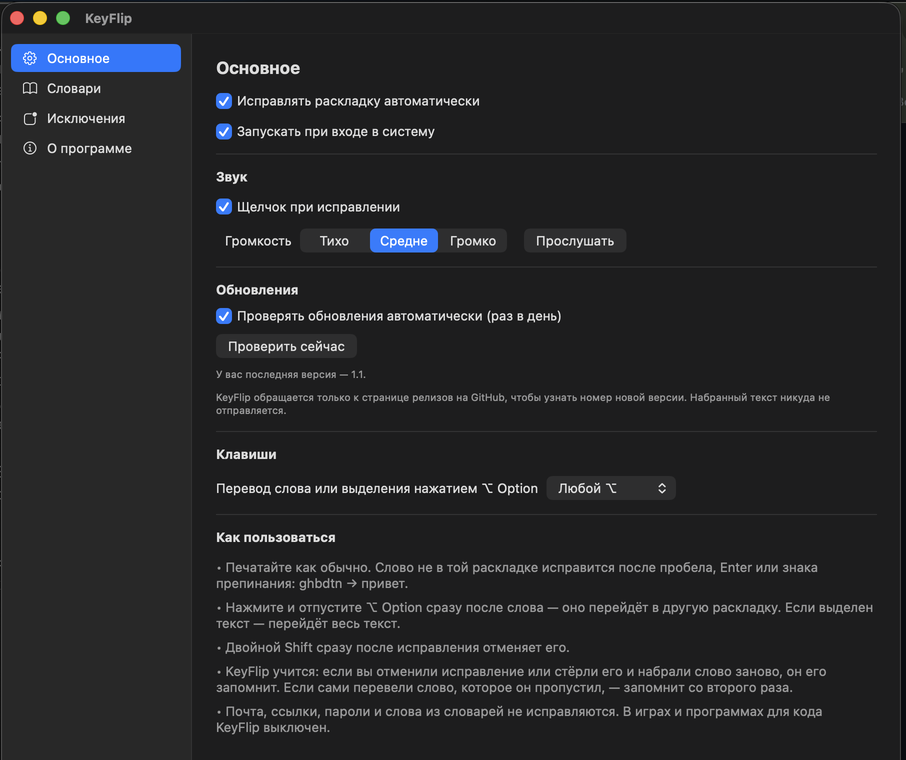

<h1 align="center">SwapType</h1>

<i>до версии 1.0.2 — KeyFlip</i>

<b>Бесплатный автопереключатель раскладки для macOS: русская ↔ английская.</b>

Набрали `ghbdtn` вместо «привет»? SwapType заметит и исправит прямо во время набора, и раскладку переключит сам. Живёт значком в строке меню, обновляется сам и ничего не стоит.

[Скачать последнюю версию](../../releases/latest) · [Как установить](INSTALL.ru.md) · [English](README.md) · [Что нового](CHANGELOG.ru.md) · [Сообщить о проблеме](../../issues/new/choose) · [☕ Поддержать](#support) · [Почему новое имя](#почему-новое-имя)

---

## Почему новое имя

Скажем честно: мы упёрлись в название. Программа появилась как «Раскладушка», потом стала KeyFlip — и только после выпуска 1.0.1 мы как следует проверили, свободно ли это имя. Оказалось, нет. На GitHub около десятка проектов под названием KeyFlip, и [один из них](https://github.com/pyJIoH/KeyFlip) — почти то же самое: переключатель английской и русской раскладки для Мака, который тоже переводит слово клавишей ⌥. Есть и программы KeyFlip для Windows и расширения для браузера. Две разные программы с одним именем и одной задачей — путаница для всех: в поиске, в отзывах, в сообщениях об ошибках. Наша программа там просто терялась.

Поэтому с версии 1.0.2 (16 ноября 2026) KeyFlip называется **SwapType**: «swap» — поменять местами, «type» — набирать текст. Это имя мы проверили заранее — проектов с ним не нашлось.

**Что это значит для вас:**
- **Ничего делать не нужно.** Если у вас стоит KeyFlip, он предложит обновление как обычно. После него в «Программах» будет SwapType, а KeyFlip исчезнет.
- **Всё сохраняется:** настройки, «Мои слова», «Выученные», счётчики и разрешение в «Универсальном доступе» — повторно включать ничего не нужно.
- **Старые ссылки работают:** адреса со словом keyflip GitHub сам перенаправляет на swaptype.
- Это всё та же программа того же автора, бесплатная, без рекламы и аккаунтов. Сменилось только имя и надпись на значке.

Простите за переполох — лучше сменить имя сейчас, чем потом.

## Что умеет

- **Исправляет слова, набранные не в той раскладке.** После пробела, Enter, Tab или знака препинания SwapType проверяет только что набранное слово. Если оно явно предназначалось для другой раскладки — перепечатывает его и переключает раскладку: `ghbdtn` → «привет», `руддщ` → `hello`.
- **Справляется с короткими словами.** `d ujhjl` → «в город». Если набрали `f`, сами переключили раскладку и продолжили «не», получится «а не». Настоящие короткие слова остаются: «в USB», «a day».
- **Не мешает.** Обычные слова, сокращения и названия вроде ok, zoom, git, docker не трогает.
- **Перевод вручную — теми клавишами, которыми удобно.** ⌥ Option, двойной Shift или своё сочетание переводят последнее слово — всё до пробела, вместе с цифрами: `чы1т` → `xs1n`. Повторное нажатие возвращает обратно, а сразу после автоисправления та же клавиша его отменяет. Если выделен текст — переводит его целиком. Привыкли к Shift, как в Caramba (двойной — слово, одиночный — раскладка)? Это один щелчок в меню.
- **Учится на ваших поправках.** Отменили исправление или стёрли его и набрали то же самое заново — SwapType запомнит слово. Сами перевели слово, которое он пропустил, — запомнит со второго раза.
- **Два словаря: «Мои слова» и «Выученные».** В «Мои» добавляйте ники, названия и жаргон; «Выученные» пополняются сами. Слова из словарей не исправляются, а набранные не в той раскладке — узнаются. Мгновенный поиск в любой раскладке, один файл для экспорта и импорта обоих словарей.
- **Мелкие опечатки:** «пирогб» → «пирог,», «ПРивет» → «Привет», «пРИВЕТ» (Caps Lock — SwapType его потом выключит) → «Привет».
- **Частицы и склеенные слова:** «почемуто» → «почему-то», «кембы» → «кем бы», «сонатуБаха» → «сонату Баха».
- **Знает бренды, сокращения и сленг:** iPhone, YouTube, ООО, PDF, «кринж», bruh не трогает, а набранные не в той раскладке исправляет: `jjj` → «ООО», `nr` → «тк», `n/l/` → «т.д.».
- **Заглавные там, где нужно:** слово, добавленное в «Мои слова» с заглавной («Никита», «GitHub»), всегда пишется так же; «ул. ленина» → «ул. Ленина»; слова, которые вы часто пишете с заглавной посреди предложения, SwapType запоминает.
- **Не трогает адреса и пароли.** Почта, ссылки и сайты (`name@gmail.com`, `https://…`) остаются как есть, как и всё, что похоже на пароль.
- **Знает, где не работать.** В играх, программах для кода и терминалах выключен сразу; любую другую программу можно добавить в исключения — «только вручную» или полностью. Нужна передышка — **пауза** на 15 минут, час или три.
- **Звуки и статистика.** Тихий щелчок при исправлении (любой звук macOS или свой файл), другой — когда выучено слово; сколько исправлено, отменено и выучено за сегодня и всего.
- **Обновляется сам.** Раз в день SwapType проверяет, нет ли новой версии, и предлагает установить её в один щелчок — без ручного скачивания .dmg. Или нажмите **«Проверить обновления»** в любой момент.

## Установка

1. Скачайте **SwapType.dmg** в разделе [Releases](../../releases/latest), откройте его и перетащите SwapType в «Программы».
2. При первом запуске macOS скажет, что не смогла проверить программу на вредоносное ПО, — так бывает со всеми бесплатными программами без платной подписи Apple. Нажмите **«Готово»**, затем **«Системные настройки → Конфиденциальность и безопасность → Всё равно открыть»**.
3. Разрешите SwapType в **«Конфиденциальность и безопасность → Универсальный доступ»** — приветственное окно подскажет, как.

**Подробная инструкция со скриншотом: [INSTALL.ru.md](INSTALL.ru.md)**

**Нужно:** macOS 12 Monterey или новее, Apple Silicon или Intel, включённые русская и английская раскладки.

## Конфиденциальность

SwapType нужен «Универсальный доступ», потому что он должен видеть набираемый текст, чтобы его исправлять. Всё происходит на вашем Маке:

- без регистрации и аналитики; в интернет SwapType выходит только раз в день — узнать на этой странице, нет ли новой версии (можно выключить), а скачивает обновление, только когда вы нажмёте **«Установить»**;
- набранный текст никуда не отправляется и не записывается на диск — пока вы печатаете, SwapType держит в памяти только текущее слово и несколько последних исправлений;
- сохраняются только слова из двух словарей («Мои слова» и «Выученные»), их можно посмотреть, найти и удалить в окне SwapType;
- поля паролей macOS сама скрывает от SwapType;
- словари хранятся в настройках программы на вашем Маке и покидают его, только если вы сами их экспортируете.

## Обратная связь

Нашли слово, которое SwapType исправляет неправильно, или есть идея? [Напишите в Issues](../../issues/new/choose) или на [xsinus@gmail.com](mailto:xsinus@gmail.com). Можно по-русски.

## 👋 Привет от s1n

SwapType — бесплатная программа, которую я делаю в свободное время: без рекламы, регистрации и аналитики. Если она избавила вас от очередного `ghbdtn` и хочется сказать спасибо, можно поддержать разработку. Любой доллар помогает и сохраняет SwapType бесплатным для всех. ❤️

### ☕ Поддержать SwapType

**Bybit** — переведите любую сумму на мой Bybit UID **593603995** (приложение Bybit → «Перевод» / Pay → пользователю Bybit по UID). Переводы между пользователями Bybit — мгновенно и без комиссии.

Нет крипты? Звезда ⭐ на этой странице, сообщение об ошибке в [Issues](../../issues/new/choose) или рассказ другу помогают не меньше.

## Лицензия

SwapType — **бесплатная программа (freeware)**: можно бесплатно пользоваться дома и на работе, на любом количестве Маков, и делиться ею. Исходный код закрыт. Подробно — в [пользовательском соглашении](LICENSE.md).

В SwapType используются списки слов [FrequencyWords](https://github.com/hermitdave/FrequencyWords) (Hermit Dave) по лицензии [CC BY-SA 4.0](https://creativecommons.org/licenses/by-sa/4.0/) — см. [NOTICE](NOTICE.md).

---

Создатель — **s1n** · © 2026
